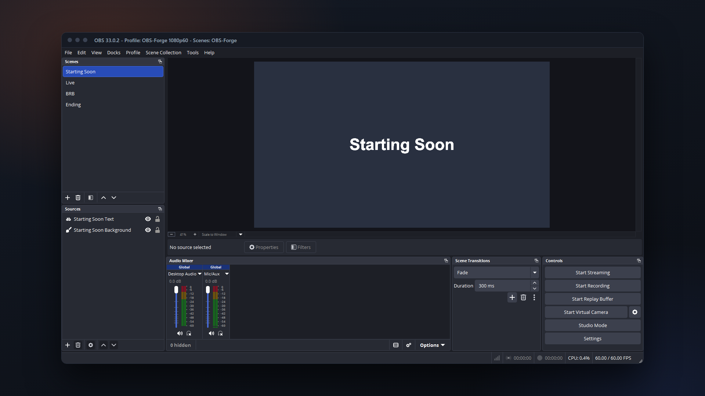
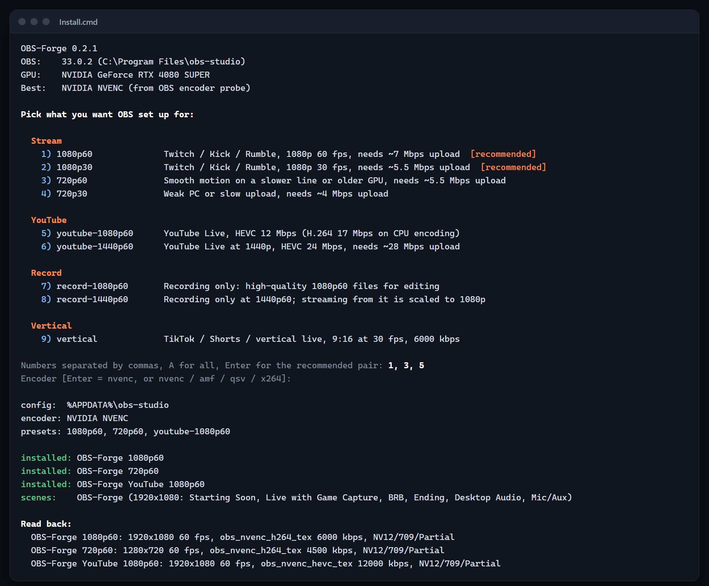
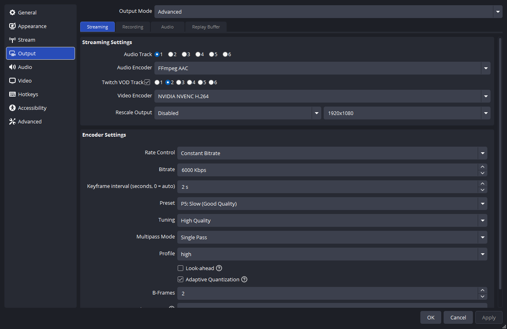
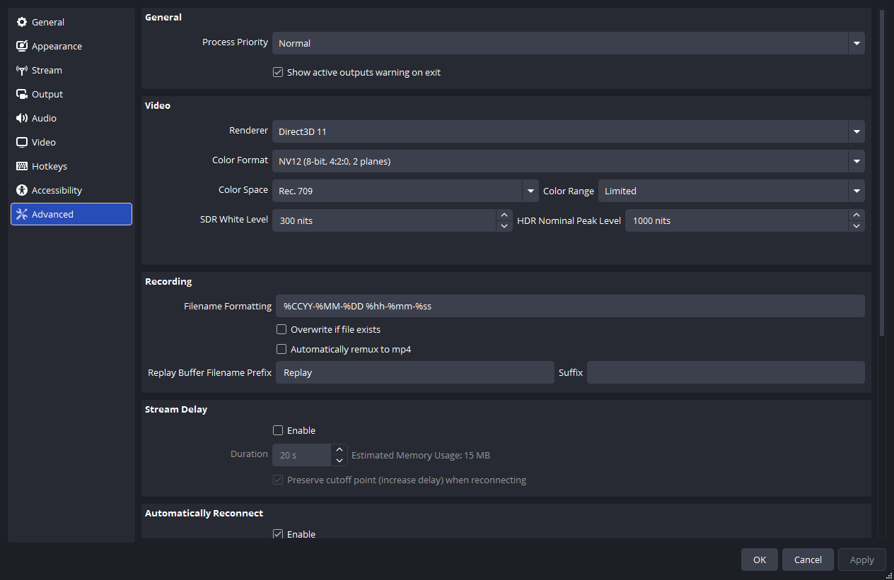
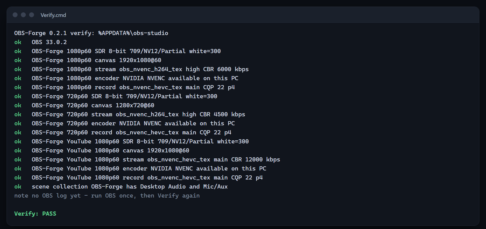

<div align="center">


# OBS-Forge

**Ready-made OBS Studio setups for streaming and recording, tuned for the GPU you have.**<br>
Pick Twitch, YouTube, recording or vertical. Connect your account. Go live.

[](https://github.com/SenjuWoo/OBS-Forge/actions/workflows/verify.yml)
[](https://github.com/SenjuWoo/OBS-Forge/releases/latest)
[](https://github.com/SenjuWoo/OBS-Forge/releases)


[](LICENSE)

**[Download the latest release](https://github.com/SenjuWoo/OBS-Forge/releases/latest)**

</div>



<sub>A real OBS Studio 33 screenshot taken right after the installer ran, framed for this page.
The four scenes, the centred label and both audio devices come from the pack. Nothing was set up by hand.</sub>

## Why

- **Starts on the first try.** Every profile is SDR 8-bit Rec.709, the format Twitch, Kick,
  Rumble and YouTube take in, so you never hit the HDR encoder errors.
- **Uses the encoder you actually have.** OBS's own encoder probes pick NVIDIA NVENC, AMD
  AMF, Intel Quick Sync or x264.
- **Ready to stream.** The Live scene already captures your fullscreen game, and the
  mixer already has your desktop audio and mic.
- **Safe on an existing OBS.** The installer never touches your own profiles or scenes,
  backs up everything it changes, and keeps your account and hotkeys when it upgrades.

## Install

1. Install [OBS Studio](https://obsproject.com) 31 or newer (33 is tested) and update your
   graphics driver.
2. **Close OBS.**
3. Download `OBS-Forge-<version>.zip` from
   [Releases](https://github.com/SenjuWoo/OBS-Forge/releases/latest) and unzip it anywhere.
4. Double-click **`Install.cmd`**. Type the numbers you want, or press Enter for the
   recommended 1080p60 + 1080p30. Press Enter again to use the encoder it detected.
5. Let it open OBS. If the Auto-Configuration Wizard appears on OBS's very first start,
   **Cancel** it, because it would overwrite these settings.
6. **Settings → Stream**, pick your service, then **Connect Account** (or paste your
   stream key).
7. Start your game in fullscreen. The **Live** scene captures it. Hit **Start
   Streaming**.



<sub>Real output of `Install.cmd` (the temp config path shown as `%APPDATA%`).</sub>

To switch later, use OBS's **Profile** menu (resolution, bitrate, encoder) and **Scene
Collection** menu (`OBS-Forge`, or `OBS-Forge Vertical` for 9:16).

## Presets

| Preset | Canvas | FPS | Stream | Made for |
|---|---|---|---|---|
| `1080p60` ★ | 1920×1080 | 60 | 6000 kbps H.264 | Twitch, Kick, Rumble |
| `1080p30` ★ | 1920×1080 | 30 | 4500 kbps H.264 | slower upload, 30 fps games |
| `720p60` | 1280×720 | 60 | 4500 kbps H.264 | smooth motion on a slower line |
| `720p30` | 1280×720 | 30 | 3000 kbps H.264 | weak PC or slow upload |
| `youtube-1080p60` | 1920×1080 | 60 | 12 Mbps HEVC | YouTube Live |
| `youtube-1440p60` | 2560×1440 | 60 | 24 Mbps HEVC | YouTube Live at 1440p |
| `record-1080p60` | 1920×1080 | 60 | – | high-quality recordings for editing |
| `record-1440p60` | 2560×1440 | 60 | (1080p if you stream) | high-quality 1440p recordings |
| `vertical` | 1080×1920 | 30 | 6000 kbps H.264 | TikTok, Shorts, vertical live |

★ installed when you choose nothing. The Twitch and YouTube bitrates come from their own
guidelines. Upload needed per preset, recording modes, and how to add your own:
**[docs/PRESETS.md](docs/PRESETS.md)**.

| Encoder family | Stream | Recording | Chosen when |
|---|---|---|---|
| NVIDIA NVENC | H.264 / HEVC, P5, high quality | separate HEVC session | OBS's NVENC probe finds it |
| AMD AMF | H.264 / HEVC, quality | separate HEVC session | OBS's AMF probe finds it |
| Intel Quick Sync | H.264 / HEVC, TU2 | separate HEVC session | OBS's Quick Sync probe finds it |
| x264 (CPU) | H.264, veryfast | shares the stream encoder | nothing else is found |

The YouTube presets fall back to H.264 at YouTube's H.264 bitrate when the encoder has no
HEVC.

## What you get in OBS

<table>
<tr>
<td width="50%"></td>
<td width="50%"></td>
</tr>
<tr>
<td><sub><b>Output.</b> NVENC H.264, CBR 6000 kbps, 2 s keyframes, P5, high quality,
2 B-frames: the Twitch guideline values.</sub></td>
<td><sub><b>Advanced.</b> NV12 / Rec.709 / Limited range, SDR white 300 nits: the
8-bit format every platform takes in.</sub></td>
</tr>
</table>



<sub><b>Verify.cmd.</b> The doctor checks every OBS-Forge profile against what was
installed, checks the encoder against your hardware, and scans OBS's newest log.</sub>

## Check it any time

Double-click **`Verify.cmd`**. It is read-only. `ok` means as installed, `warn` means you
changed something in OBS or there is something worth knowing, and `FAIL` means something
will break the stream or the colours. Exit code 0 is a pass.

## Troubleshooting

<details>
<summary><b>"Cannot perform 10-bit encode on this encoder" / the stream will not start</b></summary>

The canvas was switched to HDR (P010 or Rec.2100) under the 8-bit H.264 encoder. Re-run
`Install.cmd`, or set **Settings → Advanced → Video** back to NV12 / Rec. 709 /
Limited. `Verify.cmd` points to the profile. The whole story is in [docs/HDR.md](docs/HDR.md).
</details>

<details>
<summary><b>The Live scene is black</b></summary>

Game Capture hooks the game once it runs in **fullscreen** (borderless fullscreen counts). For a windowed
game, open the Game Capture properties and choose *Capture specific window*. Some games
with anti-cheat block capture; add a Display Capture for those.
</details>

<details>
<summary><b>My HDR game looks washed out or too dark</b></summary>

OBS tone-maps HDR games down to the SDR canvas. Adjust **Settings → Advanced → Video → SDR
White Level**: lower it toward 200 if the game looks darker than your screen, raise it
toward 400 if it looks washed out.
</details>

<details>
<summary><b>Dropped frames or "encoding overloaded"</b></summary>

Dropped frames come from the network: pick the next preset down (1080p60, then 1080p30,
then 720p60, then 720p30). Encoding overload comes from the GPU or CPU: lower the game's
settings, or use 720p. On x264, any hardware-encoder preset is lighter.
</details>

<details>
<summary><b>I have a different GPU now, or want another encoder</b></summary>

Run `Install.cmd` again: it detects the new encoder and re-applies the presets, keeping
your account and hotkeys. Force one with `.\Install.ps1 -Encoder amf` (`nvenc`, `amf`,
`qsv`, `x264`).
</details>

<details>
<summary><b>I want my old settings back</b></summary>

Every change is backed up first, to `backups\` next to the scripts (or
`%LOCALAPPDATA%\OBS-Forge\backups`). Copy a profile folder from there back to
`%APPDATA%\obs-studio\basic\profiles`. These backups can contain your stream key, so keep
them private.
</details>

## Command line

```powershell
.\Install.ps1                                   # recommended presets, auto encoder
.\Install.ps1 -Menu                             # the menu Install.cmd shows
.\Install.ps1 -List                             # presets + the encoder this PC would use
.\Install.ps1 -Preset 720p60,youtube-1080p60    # pick presets
.\Install.ps1 -Preset all -Encoder amf          # every preset, forced encoder
.\Install.ps1 -Launch                           # open OBS on the first preset afterwards
.\Install.ps1 -ConfigRoot 'D:\OBS\config\obs-studio'   # portable OBS
.\Uninstall.ps1 -Preset 720p30 -KeepScenes      # remove one profile only
```

From a plain PowerShell window, prefix each command with
`powershell -ExecutionPolicy Bypass -File`. The `.cmd` launchers do that for you.

## What it touches

- **Writes only** `basic\profiles\OBS-Forge *` and `basic\scenes\OBS-Forge*.json` in the
  OBS config folder (`%APPDATA%\obs-studio`). It never writes another profile, another
  collection, `global.ini` or `user.ini`.
- **Upgrades in place.** It keeps your connected account (`service.json`), hotkeys, audio
  devices and settings you changed, and re-applies the video and encoder settings. Your
  scene collection is replaced only with `-Force`; an old collection just gets its missing
  audio devices.
- **No overlays, alerts, chat widgets, stream keys or tokens.** The scenes are a plain
  starting point to restyle.

## More

- [docs/PRESETS.md](docs/PRESETS.md): every preset, its bitrate sources and upload needs
- [docs/SETTINGS.md](docs/SETTINGS.md): every key the pack writes, and why
- [docs/HDR.md](docs/HDR.md): why the stream is SDR, and how to do YouTube HDR yourself
- [CHANGELOG.md](CHANGELOG.md)

**Uninstall:** double-click `Uninstall.cmd`. It removes only OBS-Forge profiles and
collections, after a backup.

**Requirements:** Windows 10/11, OBS Studio 31+ (33 tested), Windows PowerShell 5.1
(built in) or PowerShell 7. A GPU with a hardware encoder is needed for the hardware
presets; without one, the presets use x264.

## License

MIT. See [LICENSE](LICENSE).
